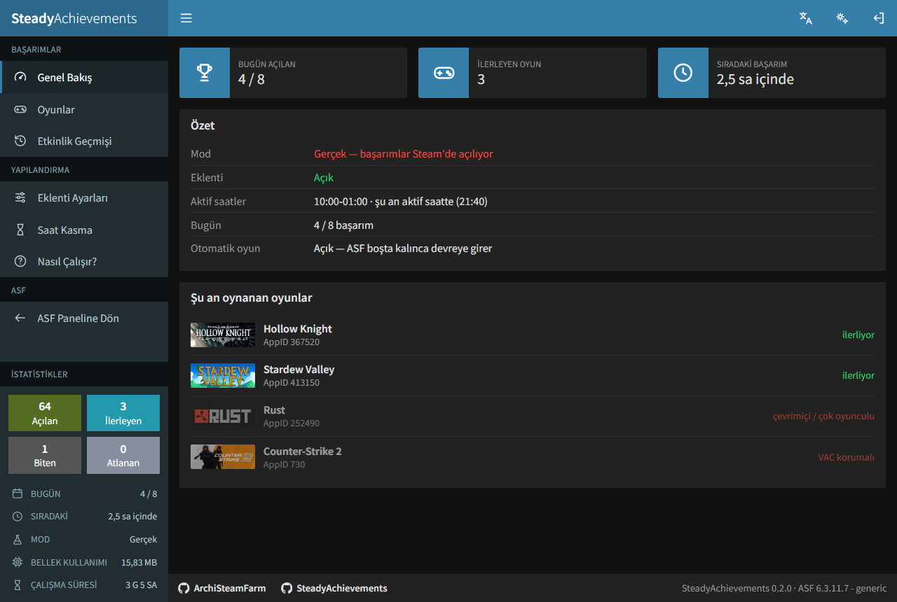
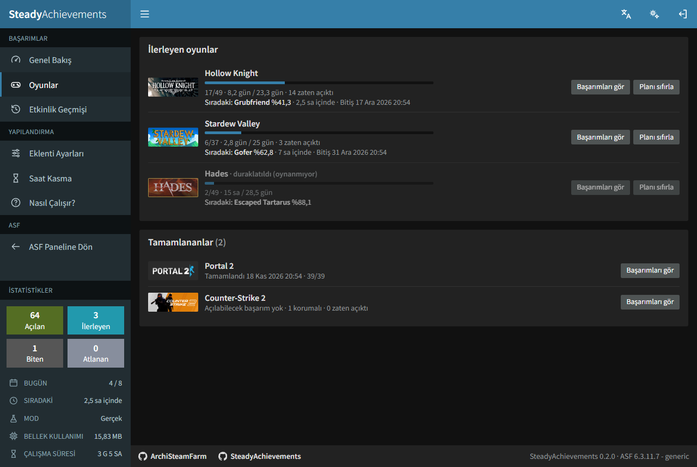
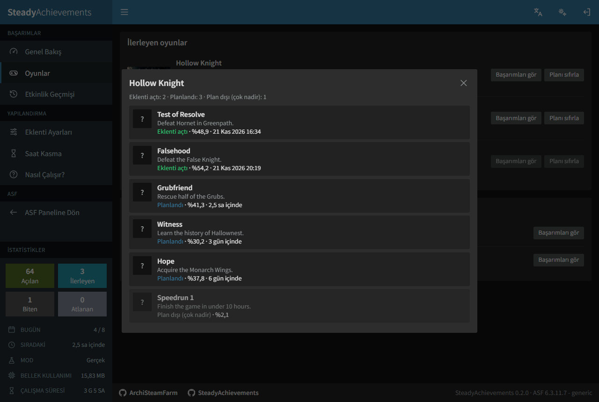
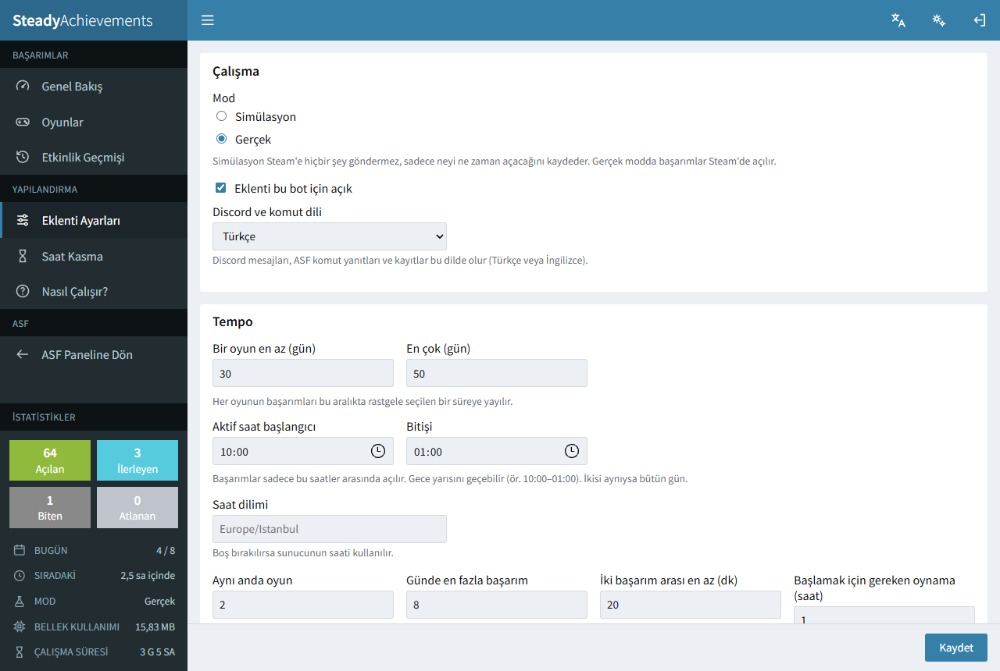
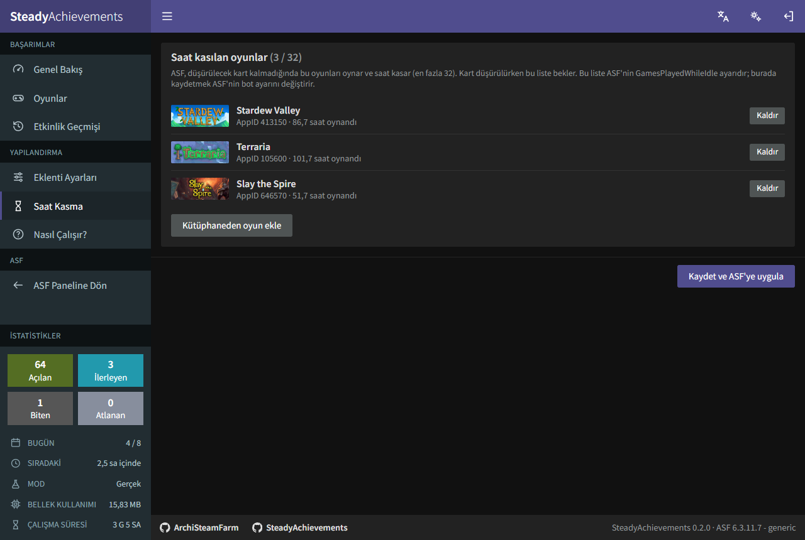
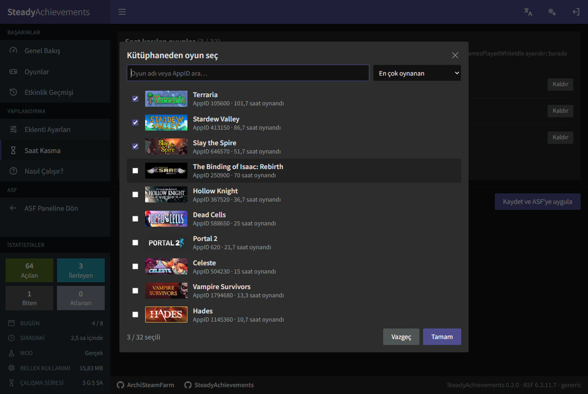
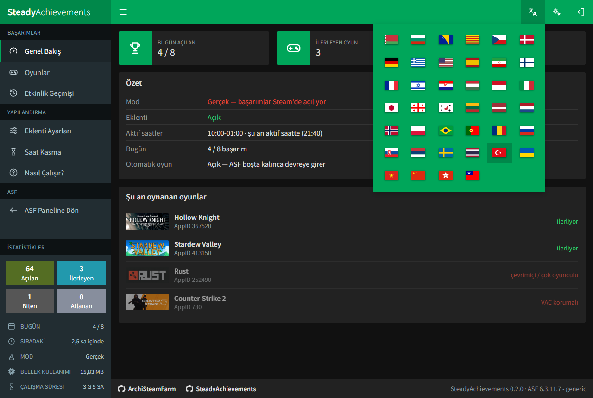
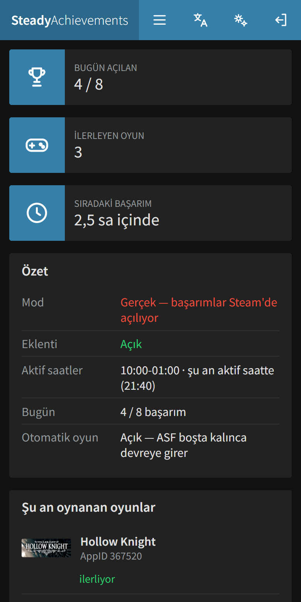
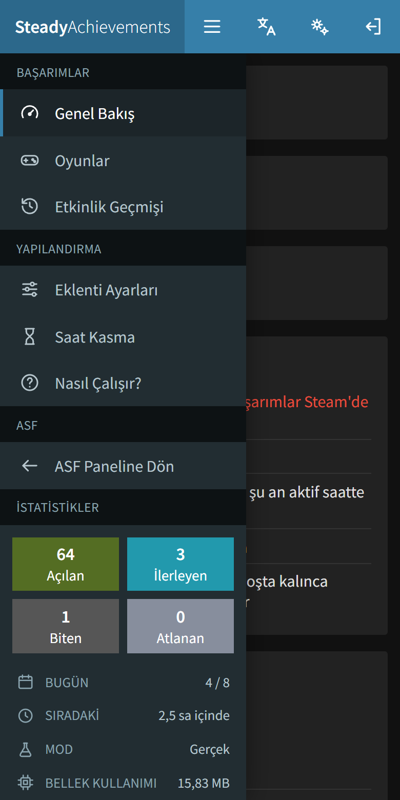

# SteadyAchievements

[Türkçe](README.md) · **English**

A plugin for [ArchiSteamFarm](https://github.com/JustArchiNET/ArchiSteamFarm) (ASF) that unlocks Steam achievements **slowly and at a natural-looking pace** in the games ASF is playing. It also has a web panel in ASF's own style with 40 languages, Discord notifications, a library game picker for hour boosting and optional auto play.

> [!WARNING]
> Unlocking achievements without playing is **against Steam's rules**. Using this plugin is entirely your own responsibility. The plugin starts in **simulation mode** and sends nothing to Steam until you switch to real mode.

## Screenshots

<p align="center"><br><sub><b>Overview (dark theme)</b></sub></p>

<table>
<tr><td align="center" width="50%"><br><sub><b>Games</b></sub></td><td align="center" width="50%"><br><sub><b>A game's achievements and plan</b></sub></td></tr>
<tr><td align="center" width="50%"><br><sub><b>Settings (light theme)</b></sub></td><td align="center" width="50%"><br><sub><b>Hour boosting</b></sub></td></tr>
<tr><td align="center" width="50%"><br><sub><b>Hour boosting: picking games from the library</b></sub></td><td align="center" width="50%"><br><sub><b>40 languages</b></sub></td></tr>
</table>

<p align="center">
&nbsp;&nbsp;&nbsp;<br>
<sub><b>On a phone: home screen and menu</b></sub>
</p>

## What it does

- **Natural pace:** each game's remaining achievements are spread randomly over your day range (30–50 days by default). Achievements most players have tend to come first, rare ones last. The wait before a rare achievement is longer.
- **Only while played:** a plan only moves while the game is really being played (card farming, `GamesPlayedWhileIdle` or auto play) and inside your **active hours**.
- **Tiered achievements:** tiers such as "30 matches" and "100 matches" always unlock from the smallest to the largest.
- **Limits:** there is always a minimum gap between achievements, plus a daily cap. Optionally it waits for a minimum playtime before starting a game, and it can skip very rare achievements.
- **Safety filters:**
  - VAC games are skipped. The allowlist cannot override this.
  - Online / multiplayer games are skipped.
  - Games with **achievement DLC you don't own** are skipped.
  - Developer / publisher blocks, a blacklist and an allowlist are available. ASF's own blacklist is respected too.
  - Achievements only the game's servers may set (protected) are never touched.
- **Auto play (optional):** when ASF has no cards left to farm, it picks eligible games from your library and plays them. Your idle list keeps playing too. It hands control back to ASF every few hours so new cards are not missed.
- **Web panel** (`/steady/`):
  - games being played, and why any are skipped;
  - games in progress and completed games, with the next achievement and its estimated date;
  - each game's achievement list;
  - settings and history.

  The panel looks like ASF's own web UI and shares its theme colour, dark mode, language and password. It offers all 40 of ASF's languages: Turkish, English, German, Spanish, French, Polish, Portuguese (BR), Russian and Simplified Chinese are complete; the others translate the main screens and fall back to English for longer help texts.
- **Hour boosting page:** edit ASF's idle list (`GamesPlayedWhileIdle`) by searching your library by name instead of typing AppIDs. The blacklist and allowlist use the same picker.
- **Discord:** it can notify you when a game is finished, on every achievement if you like, with a daily summary, and when something goes wrong.
- **Privacy:** on the server the plugin connects to nothing but Steam; the only exception is your own webhook, if you turn Discord on. The panel page, like ASF's own panel, loads its font from Google Fonts and game and achievement images from Steam's image servers in your browser.

## Requirements

- ASF **6.3.x** (tested with 6.3.11.7).
- Works on **every ASF build**: `generic`, `linux-x64`, `win-x64` and the others. The OS-specific builds are trimmed: the .NET parts ASF itself does not use are removed. The plugin is tested against them (see [tools/TrimCheck](tools/TrimCheck)). The only difference is that trimmed builds have no time zone database, so the `TimeZone` setting is unavailable and the server time is used.

## Installation

1. Download `SteadyAchievements.zip` from [Releases](../../releases). Optionally verify it with `sha512sum -c SHA512SUMS --ignore-missing`.
2. Extract the `SteadyAchievements` folder from the zip into ASF's `plugins/` folder.
3. Restart ASF. The log should show `SteadyAchievements ... loaded`.
4. Open `https://<your-asf>/steady/` (the trailing `/` is required) and enter ASF's IPC password.

## First steps

1. In **Settings**, choose your active hours and pace.
2. Leave it in **simulation** for a few days. You will see `[Steady] [Simulation] Would unlock ...` lines in the log and the plans in the panel.
3. When you are happy with it, choose **Real** and save. Simulated progress is discarded and plans are rebuilt from your account's real state.

## Settings

Settings are kept per bot in `config/SteadyAchievements/<bot>.settings.json`. Change them from the panel; no restart is needed.

| Setting | Default | Description |
|---|---|---|
| `Enabled` | `true` | Whether the plugin is on for this bot. |
| `Simulation` | `true` | In simulation nothing is sent to Steam. |
| `Language` | `tr` | Language for Discord, command replies and log lines (`tr` / `en`). |
| `MinDays` / `MaxDays` | `30` / `50` | Range of days a game's achievements are spread over. |
| `ActiveHours` | `10:00-01:00` | Hours in which achievements may unlock. The window may cross midnight; equal start and end means all day. |
| `TimeZone` | server time | IANA id, e.g. `Europe/Istanbul`. Generic build only; trimmed builds use the server time. |
| `MaxActiveGames` | `2` | How many games progress at the same time. |
| `MinGapMinutes` | `20` | Shortest gap between two achievements, in minutes, across the whole bot. |
| `MaxPerDay` | `8` | Maximum achievements per day. |
| `MinPlaytimeHours` | `1` | A game is not started before its Steam playtime reaches this many hours. |
| `SkipRarerThan` | `0` | Never unlock achievements that fewer than this % of players have (0 = off). |
| `ExcludeVac` | `true` | Skip VAC games. |
| `ExcludeOnline` | `true` | Skip online / multiplayer games. |
| `ProtectDlc` | `true` | Skip games with achievement DLC you don't own. |
| `RespectAsfBlacklist` | `true` | Also skip the games in ASF's own `Blacklist`. |
| `Blacklist` / `Allowlist` | `[]` | AppID lists. The allowlist bypasses the online, DLC and developer checks, but never the VAC check. |
| `BlockedDevelopers` / `BlockedPublishers` | `[]` | Never touch games by these developers / publishers. |
| `AutoPlay` | `false` | Pick and play eligible games while ASF is idle. |
| `AutoPlayRotateHours` | `4` | During auto play, how often (in hours) ASF gets a break to check for cards. |
| `DiscordWebhook` | empty | Discord webhook URL. |
| `NotifyCompleted` / `NotifyEachUnlock` / `NotifyDailySummary` / `NotifyProblems` | `true` / `false` / `true` / `true` | Which events send a notification. |
| `DailySummaryHour` | `23` | Hour of the daily summary. |

## Commands

In ASF's console or Steam chat, type `steady` (or `sa`) followed by:

| Command | What it does |
|---|---|
| `status` | Shows the status and the games in progress. |
| `on` / `off` | Turns the plugin on / off. |
| `sim` / `real` | Switches to simulation / real mode. |
| `auto on` / `auto off` | Turns auto play on / off. |
| `plan <appid>` | Shows a game's plan. |
| `replan <appid>` | Deletes a game's plan; it is rebuilt while the game is played. |

You can add bot names at the end, e.g. `steady status ASF`. The commands need **Master** access in ASF.

## How it works

Time is measured in "active minutes": every minute in which the game is played inside the active hours.

1. **Budget:** a random number of days between `MinDays` and `MaxDays`, times the active minutes per day. This is then scaled by the share of achievements still left, so a half-finished game gets about half the time.
2. **Order:** each achievement gets the key `1.35 · ln(percent) + Gumbel noise`, and achievements are sorted from the largest key to the smallest. This favours common achievements without fixing the order.
3. **Tiers:** tiered achievements such as "Play 30 matches" and "Play 100 matches" always unlock from the smallest to the largest. Achievements driven by the same stat are ordered by the stat's target; the same sentence with different numbers is ordered by its number.
4. **Gaps:** the wait before an achievement is proportional to `1 + ln(100 / percent)`, with log-normal noise. The gaps are scaled to fill the budget, and none is shorter than `MinGapMinutes`.
5. **Every minute:** the eligible games being played (up to `MaxActiveGames`) advance one minute. The single most overdue achievement unlocks, always respecting the minimum gap and the daily cap.

Right before an unlock, the account's current state is read from Steam again. If the achievement is already unlocked (for example because you earned it in game), it is skipped. If Steam returns an error, the game waits 30 minutes; if the same achievement fails 3 times, it is skipped.

## Building

```sh
git clone --recurse-submodules https://github.com/Karrp0/SteadyAchievements.git
cd SteadyAchievements
dotnet test SteadyAchievements.Tests -c Release
dotnet build SteadyAchievements -c Release
```

The output goes to `SteadyAchievements/bin/Release/net10.0/` and contains `SteadyAchievements.dll`, `SteadyAchievements.deps.json` and `www/`. Each version's zip and its `SHA512SUMS` are on the [Releases](../../releases) page.

If something misbehaves on a trimmed ASF build, start ASF with the environment variable `STEADY_SELFTEST=1`; the log line `[Steady self-test] done: N/N passed` exercises every part of the plugin. Details: [tools/TrimCheck](tools/TrimCheck).

## License

[Apache 2.0](LICENSE.txt). ASF is also licensed under Apache 2.0.
