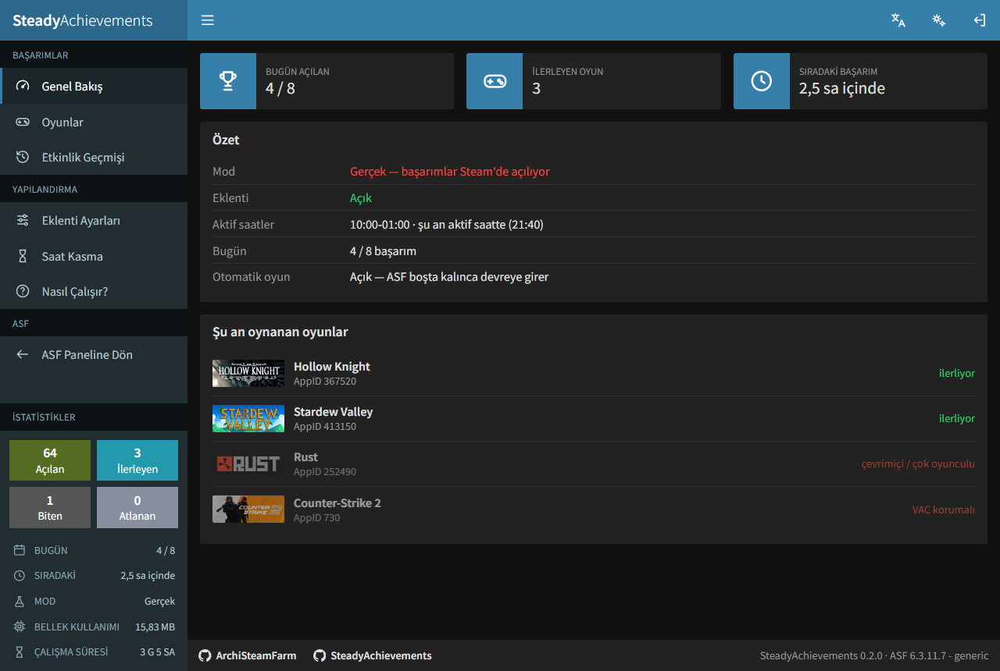
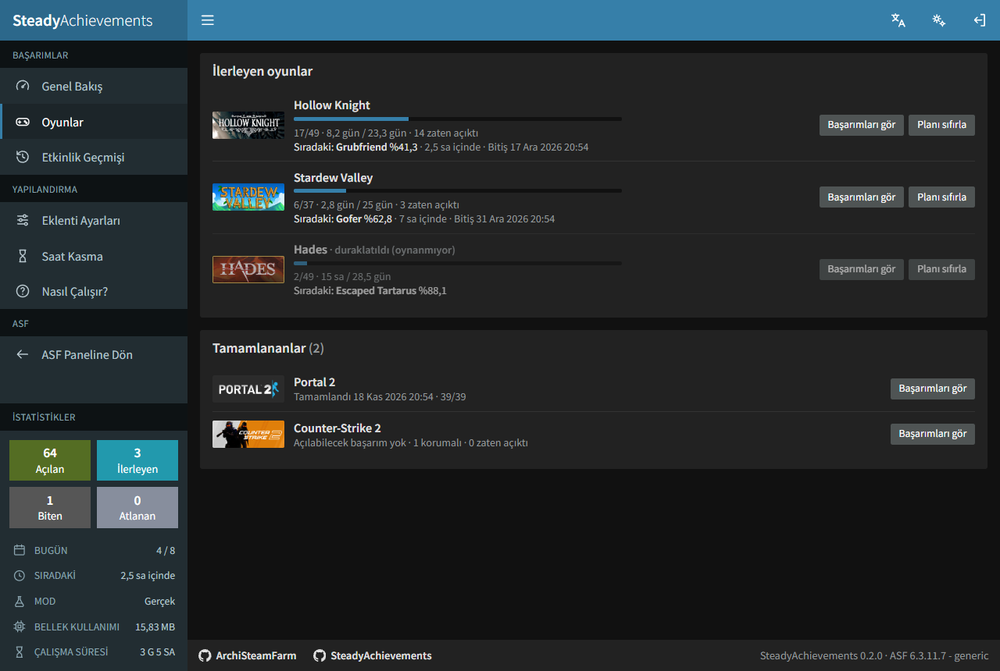
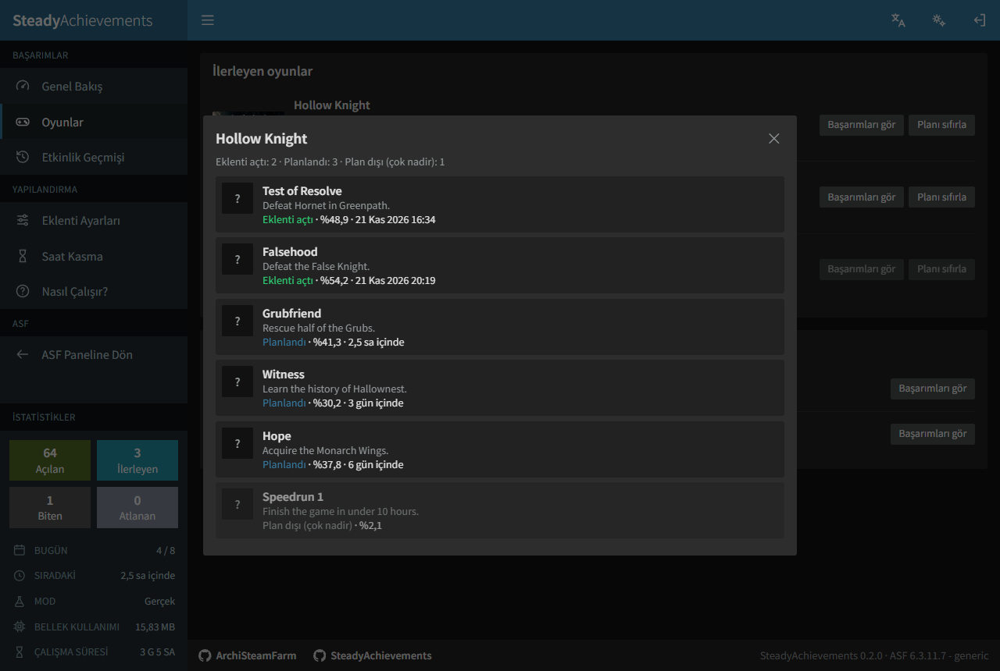
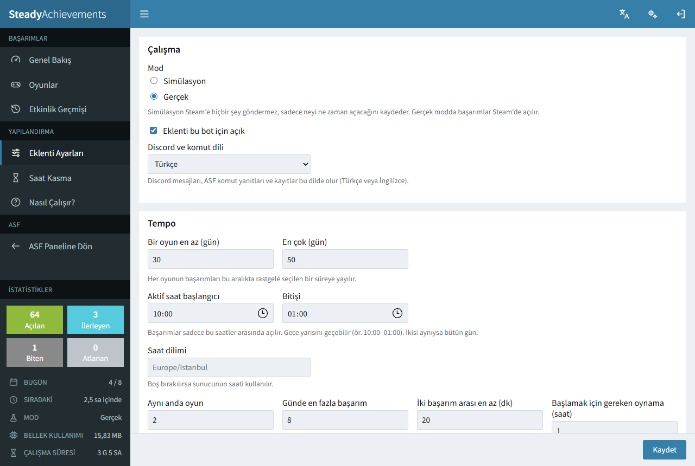
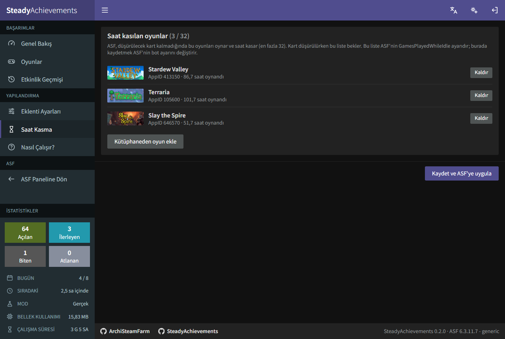
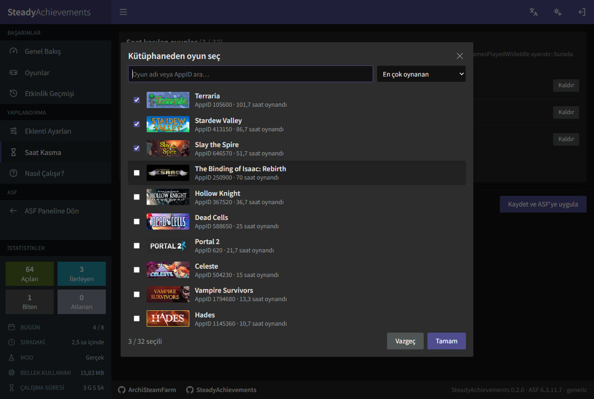
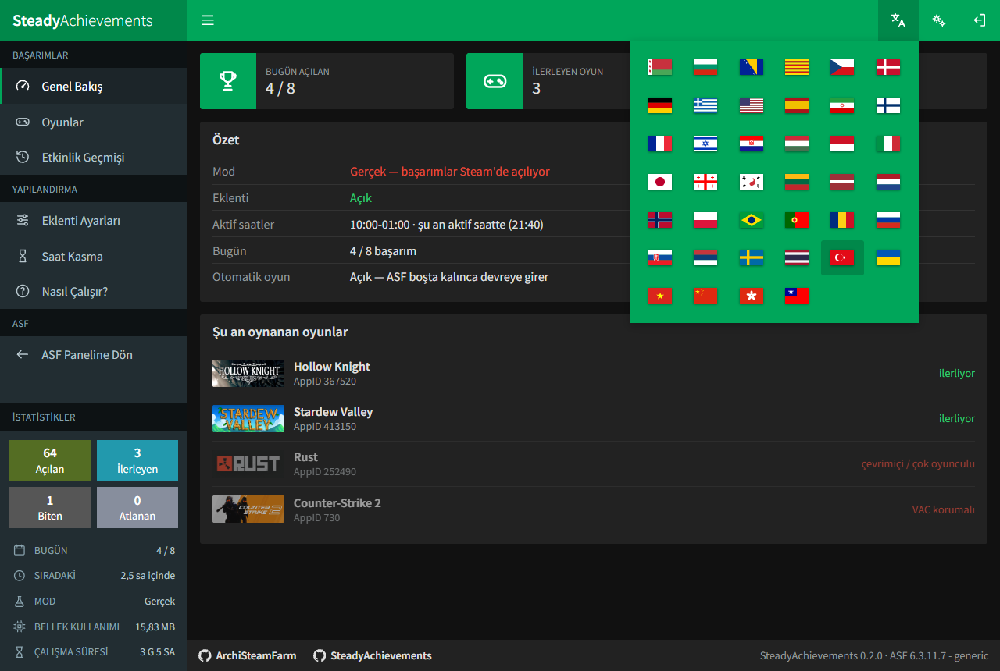
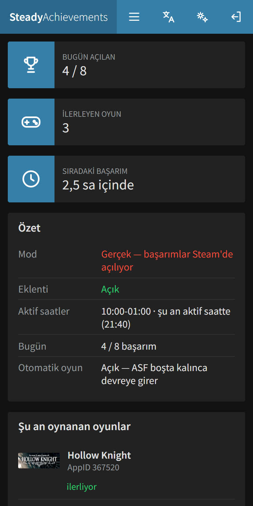
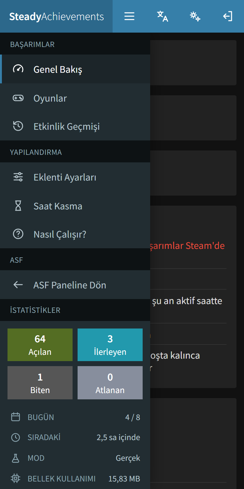

# SteadyAchievements

[English](README.md) · **Türkçe**

[ArchiSteamFarm](https://github.com/JustArchiNET/ArchiSteamFarm) (ASF) için bir eklenti. ASF'nin oynadığı oyunlarda Steam başarımlarını **yavaş, doğal görünen bir tempoyla** açar. Ayrıca ASF'nin görünümünde 40 dilli bir web paneli, Discord bildirimleri, saat kasmak için kütüphaneden oyun seçme ve isteğe bağlı otomatik oyun özelliği var.

> [!WARNING]
> Başarımları oynamadan açmak **Steam kurallarına aykırıdır**. Eklentiyi kullanmak tamamen senin sorumluluğundadır. Eklenti **simülasyon modunda** başlar ve sen gerçek moda geçene kadar Steam'e hiçbir şey göndermez.

## Ekran görüntüleri

<p align="center"><br><sub><b>Genel bakış (koyu tema)</b></sub></p>

<table>
<tr><td align="center" width="50%"><br><sub><b>Oyunlar</b></sub></td><td align="center" width="50%"><br><sub><b>Bir oyunun başarımları ve planı</b></sub></td></tr>
<tr><td align="center" width="50%"><br><sub><b>Ayarlar (açık tema)</b></sub></td><td align="center" width="50%"><br><sub><b>Saat kasma</b></sub></td></tr>
<tr><td align="center" width="50%"><br><sub><b>Saat kasma: kütüphaneden oyun seçme</b></sub></td><td align="center" width="50%"><br><sub><b>40 dil</b></sub></td></tr>
</table>

<p align="center">
&nbsp;&nbsp;&nbsp;<br>
<sub><b>Telefonda: ana ekran ve menü</b></sub>
</p>

## Ne yapar?

- **Doğal tempo:** Her başarım, oyuncuların yüzde kaçının açtığına göre belirli bir oynama süresinden sonra açılır. Normal tempoda oyuncuların %30'unun açtığı bir başarım yaklaşık 1 saat, %10'u 4 saat, %1'i 17 saat oynadıktan sonra gelir. Süreler her seferinde biraz değişir; oyunun Steam'deki mevcut oynama süresi de sayılır.
- **Sadece oynanırken:** Plan sadece oyun gerçekten oynanırken (kart düşürme, `GamesPlayedWhileIdle` ya da otomatik oyun) ilerler. Oynama her saatte sayılır, ama başarımlar sadece belirlediğin **aktif saatlerde** açılır.
- **Kademeli başarımlar:** "30 maç", "100 maç" gibi kademeler her zaman küçükten büyüğe açılır.
- **Sınırlar:** İki başarım arasında her zaman bir en az süre bırakılır, günlük bir sınır da var. İstersen oyunda belli bir oynama süresi dolmadan hiç başlamaz, çok nadir başarımları da atlayabilir.
- **Güvenlik filtreleri:**
  - VAC'lı oyunlar atlanır. İzin listesi bunu aşamaz.
  - Çevrimiçi / çok oyunculu oyunlar atlanır.
  - **Sahip olmadığın, başarım içeren DLC'si** olan oyunlar atlanır.
  - Geliştirici / yayıncı engeli, kara liste ve izin listesi var. ASF'nin kendi kara listesine de uyar.
  - Sadece oyun sunucusunun açabildiği (korumalı) başarımlara hiç dokunulmaz.
- **Otomatik oyun (isteğe bağlı):** ASF'nin düşüreceği kart kalmadığında kütüphanendeki uygun oyunları kendisi seçip oynatır. Senin oyun listen de oynanmaya devam eder. Belirli aralıklarla kontrolü ASF'ye bırakır ki yeni kartlar kaçmasın.
- **Web paneli** (`/steady/`): oynanan oyunlar ve neden atlandıkları, ilerleyen ve biten oyunlar, sıradaki başarım ve tahmini tarihi, her oyunun başarım listesi, ayarlar ve geçmiş. ASF panelinin görünümünde; tema rengi, karanlık mod, dil ve şifre ASF ile ortak. ASF'nin 40 dilinin hepsi var: Türkçe, İngilizce, Almanca, İspanyolca, Fransızca, Lehçe, Portekizce ve Rusça ile Basitleştirilmiş Çince eksiksiz; diğerlerinde ana ekranlar çevrili, uzun açıklamalar İngilizce.
- **Saat kasma sayfası:** ASF'nin oyun listesi (`GamesPlayedWhileIdle`) AppID yazmadan, kütüphanende oyun adıyla aranıp seçilerek düzenlenir. Kara liste ve izin listesi için de aynı seçici var.
- **Discord:** oyun bitince, istersen her başarımda, günlük özet olarak ve sorun çıkınca haber verir.
- **Gizlilik:** Eklenti sunucuda Steam dışında hiçbir yere bağlanmaz; tek istisna, Discord'u açarsan senin webhook adresin. Panel sayfası tarayıcında, ASF'nin kendi paneli gibi yazı tipini Google Fonts'tan, oyun ve başarım resimlerini Steam'in resim sunucusundan yükler.

## Gereksinimler

- ASF **6.3.x** (6.3.11.7 ile test edildi).
- ASF'nin **bütün sürümlerinde** çalışır: `generic`, `linux-x64`, `win-x64` vb. İşletim sistemine özel sürümler "kırpılmıştır" (trimmed), yani .NET'in ASF'nin kullanmadığı parçaları çıkarılmıştır. Eklenti bu sürümlere karşı test edilir (bkz. [tools/TrimCheck](tools/TrimCheck)). Tek fark şu: kırpılmış sürümlerde saat dilimi veritabanı yoktur, bu yüzden `TimeZone` ayarı kullanılamaz ve sunucunun saati geçerli olur.

## Kurulum

1. **İndir.** [Releases](../../releases) sayfasından en son sürümün `SteadyAchievements.zip` dosyasını indir.
   İstersen dosyanın bozulmadığını `SHA512SUMS` ile doğrula:
   - Linux / macOS: `sha512sum -c SHA512SUMS --ignore-missing`
   - Windows (PowerShell): `(Get-FileHash SteadyAchievements.zip -Algorithm SHA512).Hash` çıktısını `SHA512SUMS` içindeki değerle karşılaştır.
2. **Çıkar.** Zip'in içindeki `SteadyAchievements` klasörünü ASF'nin `plugins` klasörüne çıkar. `plugins` klasörü, ASF programının (`ArchiSteamFarm.exe` / `ArchiSteamFarm`) yanındadır. Sonuç şöyle görünmeli:
   ```
   ASF klasörü/
   ├── config/
   ├── plugins/
   │   └── SteadyAchievements/
   │       ├── SteadyAchievements.dll
   │       ├── SteadyAchievements.deps.json
   │       └── www/
   └── ArchiSteamFarm(.exe)
   ```
3. **ASF'yi yeniden başlat.** Kayıtta (konsol ya da `log.txt`) `SteadyAchievements ... loaded` satırı görünmeli. ASF, eklentiyi her botta otomatik olarak çalıştırır.
4. **Paneli aç.** Panel ASF'nin web arayüzü (IPC) üzerinden çalışır. IPC varsayılan olarak açıktır.
   - ASF aynı bilgisayardaysa: `http://127.0.0.1:1242/steady/`
   - ASF'yi kendi alan adınla yayınladıysan: `https://<asf-adresin>/steady/`

   Sondaki `/` gerekli. ASF'de `IPCPassword` belirlediysen şifre sorulur; ASF'nin kendi paneline girdiysen aynı şifre otomatik kullanılır. İnternete açık bir ASF'de mutlaka bir `IPCPassword` belirle.

### Güncelleme

`plugins/SteadyAchievements` klasörünün içeriğini yeni sürümün dosyalarıyla değiştir ve ASF'yi yeniden başlat. Ayarlar, planlar ve geçmiş `config/SteadyAchievements/` klasöründe durur; güncellemede silinmez.

### Kaldırma

ASF'yi durdur, `plugins/SteadyAchievements` klasörünü sil. Ayarları ve geçmişi de silmek istersen `config/SteadyAchievements` klasörünü de sil.

## İlk kullanım

1. Sol menüden **Eklenti Ayarları** sayfasını aç; aktif saatleri ve tempoyu belirle.
2. Birkaç gün **simülasyonda** bırak. Kayıtta `[Steady] [Simülasyon] Açılacaktı: ...` satırlarını, panelde de planları göreceksin.
3. Memnunsan **Gerçek** modunu seçip kaydet. Simülasyonda yapılan ilerleme silinir ve planlar hesabının gerçek durumundan yeniden kurulur.
4. İstersen **Saat Kasma** sayfasından ASF'nin saat kastığı oyunları kütüphanenden seç.

## Ayarlar

Ayarlar her bot için ayrı tutulur: `config/SteadyAchievements/<bot>.settings.json`. Panelden değiştirmen yeterli, yeniden başlatma gerekmez.

| Ayar | Varsayılan | Açıklama |
|---|---|---|
| `Enabled` | `true` | Eklenti bu bot için açık mı. |
| `Simulation` | `true` | Simülasyonda Steam'e hiçbir şey gönderilmez. |
| `Language` | `tr` | Discord, komut yanıtları ve kayıt dili (`tr` / `en`). |
| `PaceScale` | `1` | Her başarımın arkasındaki oynama süresini çarpar: `0.5` çok hızlı, `0.75` hızlı, `1` normal, `1.5` yavaş, `2` çok yavaş (0.25–4 arası). |
| `ActiveHours` | `10:00-01:00` | Başarımların açılabileceği saatler. Gece yarısını geçebilir; başlangıç ve bitiş aynıysa bütün gün. |
| `TimeZone` | sunucu saati | IANA adı, ör. `Europe/Istanbul`. Sadece generic sürümde; kırpılmış sürümlerde sunucu saati kullanılır. |
| `MaxActiveGames` | `2` | Aynı anda ilerleyen oyun sayısı. |
| `MinGapMinutes` | `20` | İki başarım arasındaki en kısa süre (dakika, bot genelinde). |
| `MaxPerDay` | `8` | Günde en fazla başarım. |
| `MinPlaytimeHours` | `1` | Steam'deki oynama süresi bu kadar saate ulaşmadan oyuna başlanmaz. |
| `SkipRarerThan` | `0` | Oyuncuların % kaçından azının açtığı başarımlar hiç açılmasın (0 = kapalı). |
| `ExcludeVac` | `true` | VAC'lı oyunları atla. |
| `ExcludeOnline` | `true` | Çevrimiçi / çok oyunculu oyunları atla. |
| `ProtectDlc` | `true` | Sahip olmadığın başarımlı DLC'si olan oyunları atla. |
| `RespectAsfBlacklist` | `true` | ASF'nin `Blacklist` ayarındaki oyunları da atla. |
| `Blacklist` / `Allowlist` | `[]` | AppID listeleri. İzin listesi çevrimiçi, DLC ve geliştirici kontrollerini aşar; VAC'ı aşamaz. |
| `BlockedDevelopers` / `BlockedPublishers` | `[]` | Bu geliştiricilerin / yayıncıların oyunlarına dokunma. |
| `AutoPlay` | `false` | ASF boştayken uygun oyunları kendisi seçip oynatır. |
| `AutoPlayRotateHours` | `4` | Otomatik oyunda ASF'nin kart kontrolü için kaç saatte bir ara verileceği. |
| `DiscordWebhook` | boş | Discord webhook adresi. |
| `NotifyCompleted` / `NotifyEachUnlock` / `NotifyDailySummary` / `NotifyProblems` | `true` / `false` / `true` / `true` | Hangi durumlarda bildirim gönderilecek. |
| `DailySummaryHour` | `23` | Günlük özetin gönderileceği saat. |

## Komutlar

ASF komut satırında ya da Steam sohbetinde `steady` (kısaca `sa`) ve ardından:

| Komut | Ne yapar |
|---|---|
| `status` | Durum ve ilerleyen oyunlar. |
| `on` / `off` | Eklentiyi aç / kapat. |
| `sim` / `real` | Simülasyon / gerçek mod. |
| `auto on` / `auto off` | Otomatik oyunu aç / kapat. |
| `plan <appid>` | Bir oyunun planını gösterir. |
| `replan <appid>` | Bir oyunun planını siler; oyun oynanırken yeniden kurulur. |

Sona bot adları eklenebilir, ör. `steady status ASF`. Komutlar ASF'de **Master** yetkisi ister.

## Nasıl çalışır?

Zaman oynama dakikasıyla ölçülür: oyunun oynandığı her dakika. Yeni bir plan oyunun Steam'deki mevcut oynama süresinden başlar.

1. **Oynama süresi:** Her başarıma `0,8 · PaceScale · ln(100 / yüzde)²` saatlik bir hedef verilir (en az 6 dakika) ve log-normal gürültüyle çarpılır. Yüzdesi bilinmeyen başarımlar %50 sayılır.
2. **Sıra:** Başarımlar hedeflerine göre sıralanır; yaygın olanlar genelde önce gelir ama yakın olanların yeri değişebilir.
3. **Kademeler:** "30 maça gir" ile "100 maça gir" gibi kademeli başarımlar her zaman küçükten büyüğe açılır. Aynı sayaca bağlı olanlar sayacın hedefine göre, aynı cümlenin farklı sayılı halleri de içindeki sayıya göre sıralanır.
4. **Aralıklar:** Açılış zamanları bu sırayla hedefleri izler ve iki başarım arasında hiçbir zaman `MinGapMinutes` değerinden az süre olmaz.
5. **Her dakika:** Oynanan ve uygun olan oyunlar (en fazla `MaxActiveGames`) bir dakika ilerler. Aktif saatlerdeyse vakti gelmiş en gecikmiş tek başarım açılır; en kısa aralık ve günlük sınır her zaman korunur.

Bir başarım açılmadan hemen önce Steam'deki güncel durum tekrar okunur. Başarım zaten açıksa (örneğin oyunda açmışsan) atlanır. Steam hata verirse oyun 30 dakika bekletilir; aynı başarım 3 kez başarısız olursa atlanır.

## Derleme

```sh
git clone --recurse-submodules https://github.com/Karrp0/SteadyAchievements.git
cd SteadyAchievements
dotnet test SteadyAchievements.Tests -c Release
dotnet build SteadyAchievements -c Release
```

Çıktı `SteadyAchievements/bin/Release/net10.0/` klasöründe: `SteadyAchievements.dll`, `SteadyAchievements.deps.json` ve `www/`. Her sürümün zip dosyası ve `SHA512SUMS` özeti [Releases](../../releases) sayfasında.

Kırpılmış bir ASF sürümünde sorun olursa ASF'yi `STEADY_SELFTEST=1` ortam değişkeniyle başlat; kayıtta `[Steady self-test] done: N/N passed` satırı eklentinin bütün parçalarını dener. Ayrıntılar: [tools/TrimCheck](tools/TrimCheck).

## Lisans

[Apache 2.0](LICENSE.txt). ASF de Apache 2.0 lisanslıdır.
